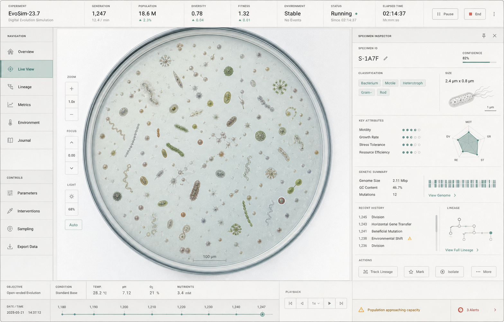
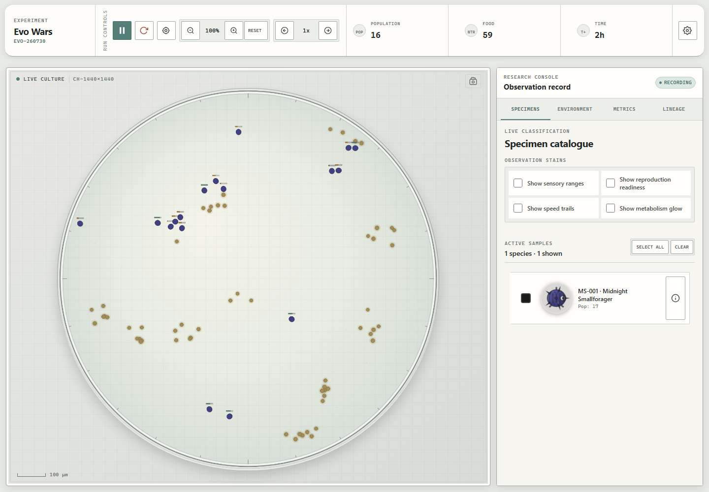
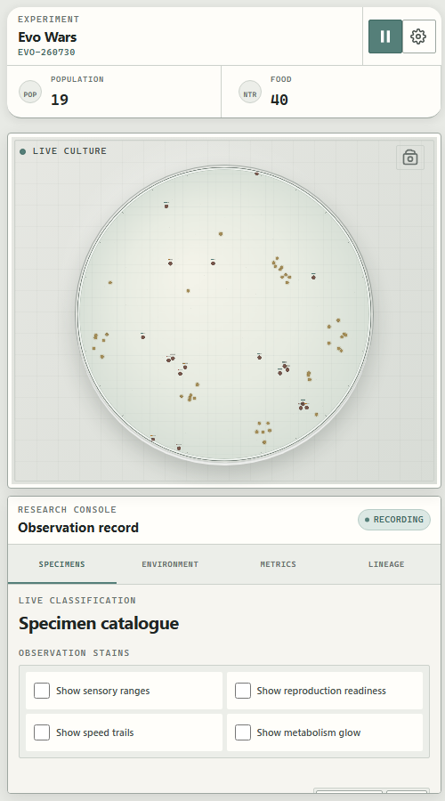
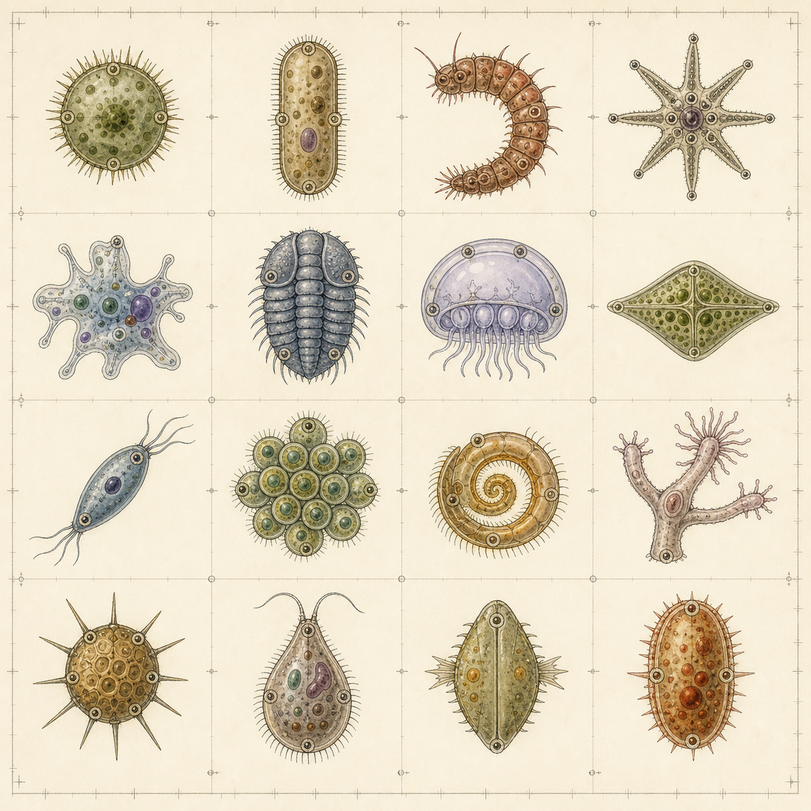

# Evo Wars Laboratory Redesign

## 1. Product Direction

Evo Wars should feel like a living experiment being observed through a scientific instrument, not a neon game dashboard.

The redesign keeps the simulation readable and playful, but changes the framing:

- The world becomes an observation chamber.
- Organisms become specimens.
- Controls become experiment protocols.
- Statistics become measurements.
- Species become classified samples.
- Genealogy becomes a lineage registry.
- Alerts become lab events.

The target mood is calm, tactile, precise, and credible. The interface should resemble a contemporary biology workstation with traces of paper records, microscope controls, specimen labels, and physical laboratory equipment.



Current implementation:





## 2. Problems in the Current Design

### Interface

- `App.css` is a 2,400-line global stylesheet with repeated dark grays, green accents, and component-specific rules.
- Most panels have the same visual weight, so the simulation, controls, species, and statistics compete for attention.
- Green highlights, glowing canvas effects, dark gradients, and emoji-heavy labels create a game-like visual language.
- The top control bar exposes actions but does not establish the experiment's identity, state, generation, or environmental context.
- The sidebar tabs are functional but generic and do not reinforce the simulation concept.
- Several canvas-rendered views use independent hard-coded colors, making a coherent redesign difficult.

### Creatures

- Every organism begins with the same row of circular body segments.
- Functional traits are added as overlays: armor rings, spikes, tendrils, eyes, fins, and toxic magenta marks.
- Strongly different genomes can still produce nearly identical silhouettes.
- Appearance is tightly coupled to the renderer rather than represented as a reusable visual phenotype.
- The render cache key tracks current overlays but has no body-plan or attachment identity.
- Generated bitmap sprites alone would not solve the problem: they would be difficult to tint, animate, rotate, connect, and keep genetically deterministic.

## 3. Design Principles

### Observation Before Decoration

The simulation remains the dominant element. UI decoration must make the world easier to interpret rather than make the interface louder.

### Scientific, Not Futuristic

Use restrained research-instrument references: porcelain, paper, graphite, brushed metal, glass, ink, measurement ticks, sample IDs, and status lamps. Avoid holograms, glow, glassmorphism, cyberpunk colors, and oversized gaming controls.

### Silhouette Communicates Biology

A creature's body plan should be recognizable before color, texture, or glow. Size, symmetry, segmentation, locomotion, sensory structures, and defense should alter the outline.

### Traits Leave Evidence

Visual features should communicate phenotype:

- Faster organisms become tapered and gain fins, cilia, or flagella.
- Armored organisms gain shell coverage, plates, or reinforced membranes.
- High-vision organisms gain larger or more numerous sensors.
- Aggressive organisms gain forward-oriented weapons or grasping structures.
- Cooperative organisms gain signal nodes, linking tendrils, or colony forms.
- Toxic organisms gain sacs, warning markings, or opaque inclusions instead of a magenta glow.

### Variation Must Be Deterministic

The same genome must always produce the same appearance. Randomness is derived from stable genome hashes, never from `Math.random()` during rendering.

## 4. Visual Language

### Color Tokens

| Token | Value | Use |
| --- | --- | --- |
| `--lab-canvas` | `#E8EAE5` | Application background |
| `--lab-surface` | `#F6F5F0` | Primary panels |
| `--lab-surface-raised` | `#FFFFFF` | Cards and focused specimen areas |
| `--lab-ink` | `#202624` | Primary text |
| `--lab-ink-muted` | `#69716D` | Labels and secondary values |
| `--lab-line` | `#CCD1CB` | Borders and dividers |
| `--lab-line-strong` | `#9EA7A1` | Active frames and chart axes |
| `--lab-accent` | `#557F79` | Selection and active experiment state |
| `--lab-accent-soft` | `#DCE8E4` | Selected rows and subtle highlights |
| `--lab-warning` | `#B77A2B` | Capacity and environmental warnings |
| `--lab-danger` | `#A54A3F` | Extinction, destructive actions, failure |
| `--lab-violet` | `#756C83` | Genetics and lineage data |
| `--lab-blue` | `#687F91` | Measurements and sensory data |

Species colors remain data colors, but saturation should be clamped for the interface. Full phenotype color appears only inside the chamber and specimen thumbnail.

### Typography

- Interface: `"IBM Plex Sans"`, `"Segoe UI"`, sans-serif.
- Measurements and sample IDs: `"IBM Plex Mono"`, `"Cascadia Mono"`, monospace.
- Use uppercase 10–11 px labels with increased tracking for instrument captions.
- Use tabular numerals for population, time, generation, and trait values.
- Replace emoji labels with the existing icon system or small scientific glyphs.

### Shape and Depth

- Panel radius: 2–4 px, not soft 10–16 px cards.
- Border: 1 px hairlines with occasional double rules around the chamber.
- Shadow: subtle neutral shadow only on raised drawers and dialogs.
- Selected state: tinted surface plus a 2 px left rule.
- Warning state: amber marker or hatched strip, never a glow.

### Texture

Use CSS-only fine grain or a very subtle repeating noise asset at less than 3% opacity. The interface should still work without texture.

## 5. Information Architecture

### Desktop Layout

```text
┌──────────────────────────────── Experiment Header ───────────────────────────────┐
│ Experiment ID | Generation | Population | Diversity | Environment | Status      │
├───────────────┬──────────────────────── Observation ───────────────┬──────────────┤
│ Navigation    │                                                   │ Inspector    │
│               │               Specimen chamber                    │              │
│ Live view     │                                                   │ Sample ID    │
│ Lineage       │                                                   │ Morphology   │
│ Metrics       │                                                   │ Traits       │
│ Environment   │                                                   │ Genome       │
│ Journal       │                                                   │ History      │
├───────────────┴───────────────────────────────────────────────────┴──────────────┤
│ Chamber conditions                         Timeline and playback controls         │
└──────────────────────────────────────────────────────────────────────────────────┘
```

The first implementation can preserve the current two-column layout. The left navigation from the concept can be deferred; the current tab bar can become a compact vertical or horizontal instrument selector.

### Mobile Layout

- Header shows status, population, and play/pause only.
- Chamber fills the screen.
- Inspector becomes a bottom sheet.
- Navigation becomes a five-item bottom rail.
- Environment controls and settings use full-screen sheets.
- Timeline collapses into a scrubber above the bottom rail.

## 6. Component Translation

| Current component | New role | Visible label |
| --- | --- | --- |
| `SimulationControls` | Experiment header | Experiment / generation / status |
| `SimulationCanvas` | Observation chamber | Live culture |
| `CreatureViewer` | Specimen catalog | Specimens |
| `EnvironmentControls` | Chamber protocol | Environment |
| `Statistics` | Measurement console | Metrics |
| `FamilyTree` | Lineage registry | Lineage |
| `GenomePopup` | Sample record sheet | Genome record |
| `ComparisonPopup` | Comparative assay | Compare specimens |
| `SettingsModal` | Instrument settings | Settings |
| Toast notifications | Lab event log | Events |

Recommended tab names:

1. Specimens
2. Environment
3. Metrics
4. Lineage

## 7. Observation Chamber

The rectangular simulation can remain internally unchanged. Its presentation changes:

- Replace the blue-black gradient with a pale desaturated culture medium.
- Add a subtle measurement grid and scale bar.
- Add a double-line chamber boundary and clipped inner field.
- Render food as nutrient granules with muted ochre or algae tones.
- Render separation sections as physical dividers with sample labels.
- Move energy, sensory, speed, and reproduction overlays into an explicit "stain/overlay" mode.
- Replace glow effects with dashed fields, thin contour lines, and translucent scientific overlays.
- Show current zoom, chamber dimensions, and scale in a small corner readout.
- Show a specimen crosshair and sample ID when an organism is selected.

The arena is a circular petri dish. Rendering, spawning, resource placement, and organism collision all use the same circular boundary so the visual vessel and simulation geometry remain aligned.

## 8. Creature Visual Phenotype

### New Layer

Add a visual phenotype between genetic expression and rendering:

```text
Genome
  -> expressed proteins
  -> functional phenotype
  -> visual phenotype
  -> modular renderer
```

Functional traits continue to drive simulation behavior. `VisualPhenotype` translates those traits plus stable protein characteristics into a coherent body plan.

### Proposed Shape

```js
{
  seed: 18273645,
  bodyPlan: 'capsule',
  symmetry: 'bilateral',
  segmentCount: 3,
  aspectRatio: 1.65,
  taper: 0.28,
  curvature: -0.14,
  membrane: {
    thickness: 0.42,
    translucency: 0.18,
    texture: 'granular'
  },
  locomotion: {
    type: 'flagella',
    count: 3,
    length: 0.72,
    placement: 'rear'
  },
  sensory: {
    type: 'eyespots',
    count: 2,
    size: 0.36,
    placement: 'front'
  },
  defense: {
    type: 'plates',
    coverage: 0.58,
    spineCount: 2
  },
  feeding: {
    type: 'filter',
    aperture: 0.31
  },
  internal: {
    nucleusCount: 1,
    vacuoleCount: 4,
    toxinSacCount: 0
  },
  pattern: {
    type: 'bands',
    density: 0.34,
    contrast: 0.28
  },
  palette: {
    primaryHue: 82,
    secondaryHue: 41,
    saturation: 38,
    lightness: 57
  }
}
```

### Body Plan Families

Start with seven families:

1. `coccoid` — circular or oval, single core.
2. `capsule` — elongated bacterium-like form.
3. `spindle` — tapered swimmer with strong front/rear orientation.
4. `segmented` — articulated chain or worm.
5. `radial` — star, flower, or wheel symmetry.
6. `amoeboid` — soft asymmetric body with lobes.
7. `colonial` — connected cluster of smaller repeated units.

Add `spiral`, `leaf`, `shield`, and `branching` after the first renderer is stable.



### Trait-to-Morphology Mapping

| Input | Primary visual effect | Secondary visual effect |
| --- | --- | --- |
| Structure protein | Body family and segment topology | Symmetry and curvature |
| Size protein | Overall scale | Membrane and organelle scale |
| Speed protein | Aspect ratio and taper | Locomotion type and length |
| Defense protein | Plate/shell coverage | Membrane thickness and spines |
| Sensory protein | Sensor count and size | Front orientation |
| Aggression protein | Weapon orientation | Mouth type and forward taper |
| Cooperation protein | Colony tendency | Link nodes and signaling marks |
| Metabolism protein | Internal organelle density | Surface texture |
| Reproduction protein | Bud scars or budding nodes | Nucleus count |
| Pigmentation protein | Palette | Marking family and contrast |

Each input should affect more than one visible property, but no single trait should control an entire creature.

### Stable Variation

Create a stable hash from:

- Gene DNA strings.
- Protein sequence.
- Species founder ID where a species-level signature is desired.

Use a seeded pseudo-random generator to choose within valid morphology ranges. Offspring with small mutations then receive small visual changes instead of unrelated random bodies.

For continuous values, derive parameters directly from normalized protein ratios. For categorical selections, use weighted thresholds with hysteresis so tiny mutations do not constantly switch body families.

## 9. Modular Renderer

### Why Procedural Modules

Canvas path modules are preferable to a large raster sprite sheet:

- They rotate and scale cleanly.
- Colors and markings remain genetically driven.
- Attachments can animate independently.
- Anchor points stay exact.
- Thousands of combinations can share a small asset library.
- Existing offscreen caching remains useful.

Generated art should guide shape language, not become the only production source.

### Module Categories

```text
body/
  coccoid
  capsule
  spindle
  segmented
  radial
  amoeboid
  colonial

surface/
  membrane
  shell
  plates
  ridges
  pores

locomotion/
  cilia
  flagella
  fins
  pseudopods

sensory/
  eyespot
  lens
  antenna
  chemical-pore

feeding/
  aperture
  filter-fan
  proboscis
  mandible

defense/
  spines
  horns
  toxin-sacs
  shield

markings/
  bands
  spots
  mottling
  bilateral-stripe
  radial-ring
```

### Anchor Model

Every body module exposes normalized anchors:

```js
{
  front: [0.5, 0],
  rear: [-0.5, 0],
  dorsal: [[0, -0.5], [0, 0.5]],
  perimeter: [...],
  segmentCenters: [...]
}
```

Attachments ask for semantic anchors instead of calculating positions from a circle. This prevents fins, eyes, and spikes from floating when body shapes change.

### Render Order

1. Grounding shadow or chamber contrast.
2. Body silhouette.
3. Membrane or shell.
4. Internal structures.
5. Surface pattern.
6. Defense structures.
7. Locomotion structures.
8. Sensory and feeding structures.
9. Selection and scientific overlays.

### Animation

- Flagella use two or three sine-controlled bezier segments.
- Cilia animate in grouped waves, not individually.
- Segments flex along the movement vector.
- Amoeboid lobes pulse slowly using seeded phase offsets.
- Internal organelles drift only in high-detail thumbnails.
- Animation state is not included in the visual cache; cache static layers and draw moving attachments separately.

### Level of Detail

- Tiny: body-family silhouette plus species color.
- Medium: silhouette, membrane, major locomotion, and sensors.
- Full: all modules, internals, texture, and markings.
- Inspector thumbnail: full detail at 4x resolution.

## 10. Suggested Code Structure

```text
src/
  design/
    tokens.css
    components.css
  rendering/
    OrganismRenderer.js
    visual/
      VisualPhenotype.js
      VisualSeed.js
      BodyGeometry.js
      ModuleRegistry.js
      palettes.js
      bodies/
      attachments/
      patterns/
  components/
    ExperimentHeader/
    ObservationChamber/
    SpecimenCatalog/
    SpecimenInspector/
    LabNavigation/
    Timeline/
```

Immediate integration points:

- `Organism.calculatePhenotype()` creates or requests `visualPhenotype`.
- `OrganismRenderer.getCacheKey()` includes the visual phenotype signature.
- `OrganismRenderer.renderBodySegments()` is replaced by body geometry dispatch.
- Existing armor, aggression, cooperation, vision, speed, and toxicity renderers become modules.
- `renderBackground()` adopts shared chamber tokens.
- Canvas charts receive a shared chart theme instead of hard-coded colors.

## 11. Implementation Sequence

### Phase 1 — Foundation

- Introduce design tokens and typography.
- Split global CSS into shell, controls, panels, dialogs, and responsive files.
- Restyle the app shell without changing component behavior.
- Replace emoji controls with the existing icon set.
- Create shared button, field, panel, badge, and measurement styles.

Exit condition: the entire app reads as one laboratory instrument even though creature rendering is unchanged.

### Phase 2 — Observation Chamber

- Replace the world background, grid, food, walls, labels, and overlays.
- Add chamber frame, scale bar, status marker, and selected-specimen crosshair.
- Add light and dark chamber modes if contrast testing requires both.

Exit condition: screenshots of the simulation no longer look like a neon arcade field.

### Phase 3 — Visual Phenotype

- Implement stable genome hashing and seeded helpers.
- Add `VisualPhenotype`.
- Implement `coccoid`, `capsule`, `spindle`, and `segmented`.
- Add semantic anchors.
- Convert existing features into attachments.
- Update cache keys and thumbnail rendering.

Exit condition: four organisms with meaningfully different genomes have clearly different silhouettes in monochrome.

### Phase 4 — Morphology Expansion

- Add `radial`, `amoeboid`, and `colonial`.
- Add feeding structures, internals, and improved markings.
- Add mutation continuity and body-family hysteresis.
- Add lightweight animation for locomotion.

Exit condition: a population screenshot contains recognizable families without relying on color.

### Phase 5 — Scientific Workflow

- Add specimen selection and inspector.
- Reframe environment controls as a protocol.
- Reframe statistics as measurements.
- Reframe genealogy as a lineage registry.
- Add event log and experiment metadata.

Exit condition: users can observe, classify, compare, and trace organisms from one coherent workspace.

### Phase 6 — Polish

- Responsive bottom-sheet behavior.
- Keyboard navigation and focus states.
- Reduced-motion mode.
- Color-blind-safe overlays.
- Performance profiling at desktop and mobile population limits.
- Screenshot and documentation updates.

## 12. Acceptance Criteria

### Interface

- No green glow, magenta glow, or blue-black game gradient remains in the default theme.
- Active state, warning, and danger are visually distinct without relying on saturation alone.
- The chamber receives the strongest visual emphasis.
- Controls retain at least 44 px touch targets on mobile.
- Text and essential controls meet WCAG AA contrast.

### Creatures

- At least seven body-plan families are possible.
- At least four major attachment categories alter silhouettes.
- The same genome produces the same visual phenotype across reloads.
- Related offspring remain visually related.
- Species can be distinguished in grayscale at normal zoom.
- Tiny, medium, full, and thumbnail render paths remain available.
- Rendering 100 desktop organisms stays within the current frame budget.

## 13. First Build Slice

The best first implementation slice is:

1. Add design tokens and laboratory app shell.
2. Restyle the header, tabs, sidebar, and common controls.
3. Redesign the chamber background and food.
4. Add `VisualPhenotype` with four body families.
5. Convert eyes, fins, plates, and spikes to anchored modules.

This slice gives an immediately visible redesign while proving the new creature architecture before expanding every screen.

## 14. Visual Reference Notes

The two reference images in `docs/design/` were generated as direction-setting artifacts. They establish mood, hierarchy, palette, silhouette quality, and biological variety. They are not intended to be copied pixel-for-pixel or shipped as functional UI/sprite assets.
